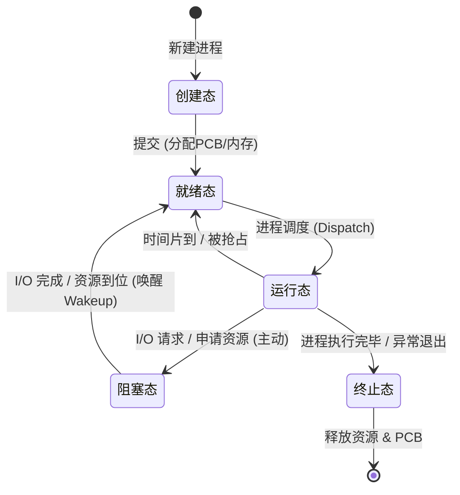

# 进程的状态与转换

进程在其生命周期中，由于与其他进程的相互制约以及系统运行环境的变化，其状态会不断发生转换。通常进程具有以下五种状态，其中前三种为基本状态。

1. **运行态**：进程正在 CPU 上执行。在单 CPU 中，任一时刻最多只有一个进程处于运行态。

2. **就绪态**：进程已获得除 CPU 外的所有必要资源，一旦获得 CPU，便可立即投入运行。系统中可能有多个就绪进程，通常组织为**就绪队列**。
**只缺少CPU**

3. **阻塞态**（等待态）：进程因等待某一事件（如资源可用、I/O 完成等）而暂停运行。此时即使 CPU 空闲，该进程也无法执行。系统通常将阻塞进程组织为**阻塞队列**，可按阻塞原因进一步划分为多个子队列。
**等待除了CPU以外的资源**
4. **创建态**：进程正处于创建过程中，尚未进入就绪态。

5. **终止态**：进程已完成执行，正在等待系统回收资源。此时进程不再参与调度，但 PCB 等信息可能暂时保留，直至完成最终清理。

# 转换的中间过程

- **就绪态 → 运行态**：就绪进程被调度程序选中，
	- 1. 获得 CPU（如分配到时间片）。

- **运行态 → 就绪态**：
	- 1.时间片用完主动让出 CPU；
	- 2.可剥夺式调度中更高优先级进程就绪，当前进程被强制切换回就绪。
	- 时间片用完

- **运行态 → 阻塞态**：**主动行为**
	-  运行中进程请求服务（如 I/O）无法立即满足，需等待外部事件，主动进入阻塞态。并非所有系统调用都导致阻塞。
	- IO操作：读磁盘
	- 资源不足：内存不足，申请临界资源但不足，缺页(数据在外存需要IO)
- [2.1进程的组成](2.1进程的组成.md#进程的阻塞和唤醒)

- **阻塞态 → 就绪态**：（唤醒）
- 所等待事件发生（如 I/O 完成），中断处理程序将其改为就绪态，重新插入就绪队列等待调度。


# 进程创建和删除的流程
[2.1进程的组成](2.1进程的组成.md#创建进程的流程)


# 进程的切换
1. 需要保存程序计数器的值（PC），并恢复新线程的PC
2. 每个线程有自己的栈，需要保存当前线程的栈基址寄存器的值，并加载新线程的栈基址
3. 一个进程的线程共享进程的虚拟地址，**不需要更新页基址寄存器的值**
4. 一个进程所打开的文件也是被所有线程共享的，不需要更新
5. 对于进程创建，删除，调度，需要内核来完成
[2.1进程错题](2.1进程错题.md#进程的切换过程)

这是为你整理的系统性复习与笔记框架，理清了**进程状态、特权级（用户态/内核态）、临界区与锁**之间的底层串联关系：

  

# 操作系统核心机制：状态流转、特权级切换与临界区

## 1. 核心铁律：状态转换 vs 处理器特权级

- **用户态仅存在于“运行态”**：只有当进程真正在 CPU 上执行用户编写的非特权业务逻辑时，才处于用户态。
    
      
    
- **所有状态迁移 100% 发生在内核态**：进程不能自行修改自身 PCB 状态。任何状态变更（阻塞、唤醒、时间片轮转调度、销毁）都必须陷入内核态，由内核代码（中断服务例程、系统调用处理、调度器）驱动。
    
      
    

## 2. 进程状态机与态转换对应表

|**状态迁移**|**触发原因**|**态转换流向**|**底层发生的核心动作**|
|---|---|---|---|
|**就绪 $\to$ 运行**|被调度器选中|**内核态 $\to$ 用户态**|调度器恢复该进程上下文（寄存器、页表），执行返回指令（如 `sysret`/`iret`）切换特权级并交出 CPU。|
|**运行 $\to$ 就绪**|时间片耗尽 / 高优先级抢占|**用户态 $\to$ 内核态**|时钟中断或外设中断强制陷入内核，保存当前现场，将 PCB 移回就绪队列，挑选下一进程。|
|**运行 $\to$ 阻塞**|主动等待事件（I/O、锁、信号）|**用户态 $\to$ 内核态**|执行系统调用（如 `read()`、`sem_wait()`）陷入内核，内核发现资源未就绪，将 PCB 置为 Blocked 并挂入等待队列，切走 CPU。|
|**阻塞 $\to$ 就绪**|**唤醒（Wakeup）**：外界事件就绪|**全程在内核态**|磁盘/网卡硬件中断或其他进程系统调用唤醒；内核将 PCB 移出等待队列，置为 Ready 并加入就绪队列。|

> **关键辨析**：
> 
>   
> 
> 1. **唤醒对象唯一**：唤醒必然且只能发生在**阻塞态**。就绪态等待的是“调度”，运行态无所谓唤醒。
>     
>       
>     
> 2. **唤醒 $\neq$ 运行**：唤醒只是重新赋予进程排队争夺 CPU 的资格（进入就绪队列），并不代表立即拿到 CPU。
>     
>       
>     

## 3. 临界区、用户态/内核态与 CPU 占用

### ① 概念解耦：临界区 $\neq$ 内核态

- **临界区本质**：访问互斥共享资源的一段**普通程序指令**。
    
      
    
- **执行特权级**：
    
      
    - **用户态临界区**：执行的是用户业务逻辑（如修改多线程全局计数器、链表），必须在**用户态**执行。
        
          
        
    - **内核态临界区**：操作系统自身的数据结构操作（如修改就绪队列、内存空闲链表），在**内核态**执行。
        
          
        

### ② 进出临界区时的态变迁（以阻塞锁/Futex 为例）

```
[用户态] 业务代码 ──► 尝试加锁 (lock)
                         │
                         ▼ (竞争/陷入内核)
[内核态] 系统调用：验证锁状态、标记占用 (若已被占则将进程置为 Blocked 并调度其他进程)
                         │
                         ▼ (获取锁成功，sysret/iret 返回)
[用户态] 【进入临界区】CPU 全速运行用户代码（修改共享资源）
                         │
                         ▼ (退出临界区，unlock)
[内核态] 系统调用：释放锁状态，唤醒等待队列中的阻塞进程
                         │
                         ▼ (sysret/iret 返回)
[用户态] 继续执行后续非临界区代码
```

### ③ 持有锁（钥匙）的人会“一直运行”吗？

**不会。持有钥匙只能保证“互斥（别人进不来）”，不能保证“独占 CPU”。**

  

- **锁与 CPU 完全解耦**：
    
      
    - **锁（钥匙）**：由互斥原语管理，决定是否有权限访问该段共享内存。
        
          
        
    - **CPU**：由调度器分配，决定是否能推进机器指令。
        
          
        
- **持有锁期间的可能状态**：
    
      
    - **运行态（占 CPU）**：拿到锁且分到时间片，正在临界区内全速执行。
        
          
        
    - **就绪态（不占 CPU）**：在临界区内执行途中，**时间片耗尽或被更高优先级任务抢占**。此时**钥匙依然攥在手里**，但被踢回就绪队列排队；别的任务因无钥匙依然无法进入。
        
          
        
    - **阻塞态（不占 CPU）**：在临界区内调用了阻塞操作（如 I/O、`sleep`）。进程**拿着钥匙进入睡眠**，导致该临界区长时间被锁死，严重降低并发吞吐。