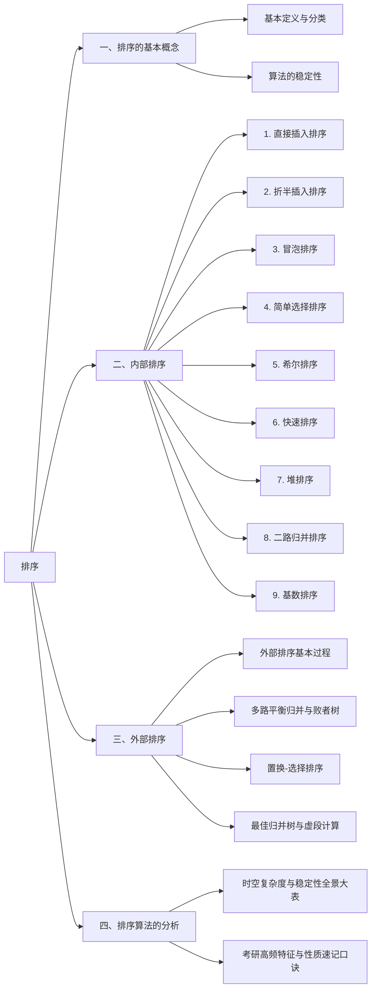

# 排序 (Sorting)

> 本文严格按照全国硕士研究生招生考试计算机专业基础（408）大纲及教材体系整理，全面涵盖考研要求的排序知识体系，重点剖析**算法思想、执行过程、数学推导与考研核心考点**。

---

## 知识框架脑图



---

# 一、排序的基本概念

### 1. 排序的定义
排序是指将一个数据元素（或记录）的任意序列，重新排列成一个按关键字递增（或递减）有序的序列。

### 2. 算法的稳定性 (Stability)
- **定义**：若待排序序列中存在多个关键字相同的元素，即 $K_i = K_j$ 且在排序前 $R_i$ 排在 $R_j$ 前面（即 $i < j$）：
  - 若排序后 $R_i$ **依然一定排在 $R_j$ 前面**，则称该排序算法是**稳定 (Stable)** 的；
  - 若排序后 $R_i$ 可能排在 $R_j$ 后面，则称该排序算法是**不稳定 (Unstable)** 的。
- **考研注意点**：
  - 稳定性是算法的固有性质，由算法的逻辑机制决定。
  - 通常，发生**长距离跨越式交换**的算法往往是不稳定的（如希尔排序、快速排序、简单选择排序、堆排序）。

### 3. 内部排序 vs 外部排序
- **内部排序**：待排序记录全部存放在计算机**内存**中进行的排序过程。
- **外部排序**：待排序记录数量极大，内存无法一次性全部容纳，必须在排序过程中不断在**内外存之间交换数据**的排序过程。

---

# 二、内部排序

按照排序机制的内在特征，内部排序可分为：**插入类、交换类、选择类、归并类、基数类**。以下涵盖考研大纲图中的全部 9 种内部排序算法。

---

## 1. 直接插入排序 (Straight Insertion Sort)
> **所属分类**：插入排序类

### 算法思想
将整个序列看作两部分：**前面的已排序有序区**与**后面的未排序无序区**。初始时有序区仅含第 1 个元素。随后依次取出无序区的首元素，在有序区中**自后向前顺序比较**，找到其应属的位置并将较大元素逐个后移，最后将其插入该空出的位置。

### 核心步骤与哨兵机制
在严蔚敏/王道考研教材中，顺序表下标 `0` 通常作为**哨兵 (Sentinel)**：
1. `A[0] = A[i]`：复制待插入元素为哨兵；
2. 循环比较 `while(A[0] < A[j]) { A[j+1] = A[j]; j--; }`；
3. **哨兵的作用**：免去了每次判断下标是否越界（`j >= 1`）的边界检查，提高执行效率。

### 代码实现 (C语言标准风格)
```c
void InsertSort(int A[], int n) {
    int i, j;
    // A[0] 作为哨兵，真实数据存放于 A[1...n]
    for (i = 2; i <= n; i++) {
        if (A[i] < A[i - 1]) {        // 仅当出现逆序时才需要插入
            A[0] = A[i];              // 设置哨兵
            for (j = i - 1; A[0] < A[j]; j--) {
                A[j + 1] = A[j];      // 大于哨兵的记录向后顺移
            }
            A[j + 1] = A[0];          // 插入到正确位置
        }
    }
}
```

### 考研考点与性能分析
- **时间复杂度**：
  - **最好情况**（序列本就有序）：只需比较 $n-1$ 次，移动 0 次，时间复杂度为 $O(n)$。
  - **最坏情况**（序列完全逆序）：比较 $\approx \frac{n^2}{2}$ 次，移动 $\approx \frac{n^2}{2}$ 次，时间复杂度为 $O(n^2)$。
  - **平均情况**：$O(n^2)$。
- **空间复杂度**：$O(1)$（仅需常数级辅助空间）。
- **稳定性**：**稳定**（遇到相等元素不发生前移越位）。
- **适用场景**：适合**基本有序**或**数据规模较小**的场景。顺序表和链表均适用。

---

## 2. 折半插入排序 (Binary Insertion Sort)
> **所属分类**：插入排序类

### 算法思想
直接插入排序在有序区中查找插入位置采用的是**顺序查找**。由于有序区是有序序列，故可利用**二分查找（折半查找）**快速确定待插入位置，以减少比较次数。

### 核心步骤
1. 取出当前待插入元素暂存到 `A[0]`（或临时变量 `temp`）；
2. 在已排序区间 `[1 ... i-1]` 中执行折半查找：不断缩小区间 `[low, high]`，直至 `low > high`；
3. 统一将 `[high + 1 ... i - 1]` 区间的元素后移一位；
4. 将元素放入 `high + 1` 位置。

### 代码实现 (C语言标准风格)
```c
void BInsertSort(int A[], int n) {
    int i, j, low, high, mid;
    for (i = 2; i <= n; i++) {
        A[0] = A[i];                  // 暂存待插入元素
        low = 1; high = i - 1;
        while (low <= high) {         // 折半查找插入位置
            mid = (low + high) / 2;
            if (A[mid] > A[0]) 
                high = mid - 1;       // 插入点在左半区
            else 
                low = mid + 1;        // 为保证稳定性，相等时放右半区
        }
        for (j = i - 1; j >= high + 1; j--) {
            A[j + 1] = A[j];          // 统一后移
        }
        A[high + 1] = A[0];           // 插入
    }
}
```

### 考研考点与性能分析
- **关键考点（重点）**：**比较次数大幅减少，但移动次数并未改变！**
  - **比较次数**：与待排序列的初始状态**无关**，仅取决于元素个数 $n$。每次折半约比较 $\lceil \log_2 i \rceil$ 次，总比较次数为 $O(n \log_2 n)$。
  - **移动次数**：依然取决于初始状态，平均与最坏仍为 $O(n^2)$。
- **时间复杂度**：仍为 $O(n^2)$。
- **空间复杂度**：$O(1)$。
- **稳定性**：**稳定**。
- **限制条件**：仅适用于**顺序存储**（因为折半查找需要根据下标进行随机访问，链表无法直接随机访问）。

---

## 3. 希尔排序 (Shell Sort)
> **所属分类**：插入排序类（又称“缩小增量排序”）

### 算法思想
直接插入排序在“序列基本有序”和“数据量较小”时效率极高。希尔排序基于此原理提出：
1. 选取一个逐步递减的**增量序列** $d_1, d_2, \dots, d_k$（其中 $d_1 < n$ 且最后一个增量必为 $d_k = 1$）；
2. 每一趟按增量 $d$ 将整个序列分割成 $d$ 个形如 $\{A[i], A[i+d], A[i+2d], \dots\}$ 的子序列；
3. 在每个子序列内部分别执行**直接插入排序**；
4. 随着 $d$ 逐渐减小，整个数组在宏观上越来越“基本有序”；最终当 $d=1$ 时，对整个数组做一次全体直接插入排序。

### 执行过程示意
若数组长为 8，初始增量序列 $d = 4, 2, 1$：
- $d = 4$：分割为 4 个子序列，内部排序；
- $d = 2$：分割为 2 个子序列，内部排序；
- $d = 1$：全表直接插入排序（此时大部分元素已在最终位置附近，移动极少）。

### 代码实现
```c
void ShellSort(int A[], int n) {
    int d, i, j;
    // 采用希尔建议的增量序列：d 每次减半，直至 d = 1
    for (d = n / 2; d >= 1; d = d / 2) {
        for (i = d + 1; i <= n; i++) {
            if (A[i] < A[i - d]) {
                A[0] = A[i];          // A[0] 暂存元素（非严格哨兵）
                for (j = i - d; j > 0 && A[0] < A[j]; j -= d) {
                    A[j + d] = A[j];  // 跨步长后移
                }
                A[j + d] = A[0];
            }
        }
    }
}
```

### 考研考点与性能分析
- **时间复杂度**：与增量序列的选择紧密相关。目前尚未得出精确的数学解析式，通常在 $O(n^{1.3}) \sim O(n^2)$ 之间。
- **空间复杂度**：$O(1)$。
- **稳定性**：**不稳定**。
  - *原因*：相同关键字若被划分到不同的子序列中，各自独立进行插入排序后，其相对位置可能被破坏。
- **限制条件**：仅适用于**顺序存储**（需利用下标跨步长定位）。

---

## 4. 冒泡排序 (Bubble Sort)
> **所属分类**：交换排序类

### 算法思想
基于相邻元素的比较和交换。从前向后（或从后向前）两两比较相邻元素，若为逆序则交换它们。每一趟冒泡都会使未排序区间中的**最大值（或最小值）像气泡一样浮动到本趟的最终位置**。

### 优化机制 (提前终止标志)
引入标志位 `bool flag`：如果某一趟扫描中**没有发生任何交换**，说明整个序列已经完全有序，可立即退出循环，避免不必要的比较。

### 代码实现
```c
void BubbleSort(int A[], int n) {
    for (int i = 0; i < n - 1; i++) {
        bool flag = false;             // 本趟是否发生交换的标志
        for (int j = 0; j < n - 1 - i; j++) {
            if (A[j] > A[j + 1]) {
                int temp = A[j];
                A[j] = A[j + 1];
                A[j + 1] = temp;
                flag = true;           // 发生了交换
            }
        }
        if (!flag) return;             // 本趟无交换，提前结束
    }
}
```

### 考研考点与性能分析
- **时间复杂度**：
  - **最好情况**（序列正序）：1 趟扫描比较 $n-1$ 次，无交换，时间复杂度为 $O(n)$。
  - **最坏情况**（序列完全逆序）：需要 $n-1$ 趟，总比较 $\frac{n(n-1)}{2}$ 次，时间复杂度为 $O(n^2)$。
  - **平均情况**：$O(n^2)$。
- **空间复杂度**：$O(1)$。
- **稳定性**：**稳定**（若两元素相等，不满足严格大于条件，不发生交换）。
- **考研特质**：**每趟排序至少将一个元素放置到其最终位置**（产生局部全局有序）。

---

## 4. 简单选择排序 (Simple Selection Sort)
> **所属分类**：选择排序类

### 算法思想
在每一趟中（例如第 $i$ 趟），通过顺序遍历在无序区 `A[i...n]` 中挑选出**关键字最小（或最大）的元素**，将其与无序区的第一个元素 `A[i]` 交换。共需进行 $n-1$ 趟。

### 代码实现
```c
void SelectSort(int A[], int n) {
    for (int i = 0; i < n - 1; i++) {
        int min_idx = i;              // 记录最小元素下标
        for (int j = i + 1; j < n; j++) {
            if (A[j] < A[min_idx]) {
                min_idx = j;          // 更新最小值下标
            }
        }
        if (min_idx != i) {           // 交换到无序区开头
            int temp = A[i];
            A[i] = A[min_idx];
            A[min_idx] = temp;
        }
    }
}
```

### 考研考点与性能分析
- **关键考点（重点）**：**元素的比较次数与序列初始状态完全无关！**
  - 无论初始状态如何，第 $i$ 趟都要比较 $(n - i)$ 次，总比较次数恒为：
    $$\sum_{i=1}^{n-1} (n - i) = \frac{n(n - 1)}{2}$$
  - 时间复杂度：最好、最坏、平均均为 $O(n^2)$。
- **空间复杂度**：$O(1)$。
- **稳定性**：**不稳定**。
  - *反例*：序列 `[2, 2*, 1]`，第一趟 1 与首个 2 交换得到 `[1, 2*, 2]`，原先两个 2 的相对次序被颠倒。
- **考研特质**：**每趟排序至少确定一个元素的最终位置**。

---


## 6. 快速排序 (Quick Sort)
> **所属分类**：交换排序类（基于分治法）
每次能确定每个子表的一个位置
### 算法思想
快速排序是内部排序中**综合平均性能最好**的算法。其核心是**分治策略 (Divide-and-Conquer)**：
1. **选取基准 (Pivot)**：在待排子表 $A[low \dots high]$ 中选定一个基准元素（通常为第一个元素）；
2. **划分操作 (Partition)**：通过双指针从两端向中间扫描交替填坑，将小于基准的元素调到左侧，大于基准的元素调到右侧，基准元素归位至最终位置 $pivotpos$；
3. **递归求解**：递归地对左子表 $A[low \dots pivotpos-1]$ 和右子表 $A[pivotpos+1 \dots high]$ 进行快速排序，直至每个子表长度为 0 或 1。

### 划分操作 (Partition 挖坑填数法)
```c
int Partition(int A[], int low, int high) {
    int pivot = A[low];               // 将第一个元素作为基准挖出
    while (low < high) {
        while (low < high && A[high] >= pivot) high--;
        A[low] = A[high];             // 比基准小的移到左端空位
        while (low < high && A[low] <= pivot) low++;
        A[high] = A[low];             // 比基准大的移到右端空位
    }
    A[low] = pivot;                   // 基准存放到最终位置
    return low;                       // 返回基准所在下标
}

void QuickSort(int A[], int low, int high) {
    if (low < high) {
        int pivotpos = Partition(A, low, high); // 划分
        QuickSort(A, low, pivotpos - 1);       // 递归排左区间
        QuickSort(A, pivotpos + 1, high);      // 递归排右区间
    }
}
```

### 考研考点与性能分析
- **时间复杂度**：
  - **平均情况**：$O(n \log_2 n)$。
  - **最好情况**：每次划分基准恰好位于正中间，递归树高度 $\log_2 n$，为 $O(n \log_2 n)$。
  - **最坏情况（高频考点）**：待排序列**原本正序或逆序**！此时每次基准均落在端点，递归树退化为单支树，递归深度为 $n$，时间复杂度恶化为 $O(n^2)$。
- **空间复杂度（递归调用栈深度）**：
  - 最好与平均：$O(\log_2 n)$；
  - 最坏情况：$O(n)$。
- **稳定性**：**不稳定**。
- **考研特质**：
  - **每趟划分至少将一个元素（基准）放置在最终位置**。
  - 若一趟排序后，**某个元素左侧全小于它、右侧全大于它**，则该元素必是该趟的基准元素（考研选择题高频排查技巧）。

---

## 7. 堆排序 (Heap Sort)
> **所属分类**：选择排序类

### 算法思想
利用**完全二叉树**的顺序存储结构实现的树形选择排序。
- **大根堆 (Max-Heap)**：树中所有非叶节点的值均 $\ge$ 其左右孩子（根节点最大）；
- **小根堆 (Min-Heap)**：树中所有非叶节点的值均 $\le$ 其左右孩子（根节点最小）。

排序流程包含两大部分：
1. **建初堆 (Build Heap)**：从最后一个非叶子节点 $\lfloor n/2 \rfloor$ 开始，逆序直至根节点 1，依次执行**向下调整 (HeadAdjust / Sift-Down)**；
2. **出堆排序**：将堆顶（最大值）与堆底最后一个元素交换（堆底元素就位），随后有效堆容量减 1，并对新的堆顶执行自顶向下的向下调整。重复 $n-1$ 次。

### 代码实现 (以大根堆递增排序为例)
```c
// 向下调整函数：将以 k 为根的子树调整为大根堆
void HeadAdjust(int A[], int k, int len) {
    A[0] = A[k];                      // A[0] 暂存子树根节点
    for (int i = 2 * k; i <= len; i *= 2) { // 沿值较大的子节点向下筛选
        if (i < len && A[i] < A[i + 1]) 
            i++;                      // 取左右孩子中的较大者
        if (A[0] >= A[i]) 
            break;                    // 筛选完毕，无需再换
        else {
            A[k] = A[i];              // 将较大子节点调整到双亲位置
            k = i;                    // 修改 k，继续向下筛选
        }
    }
    A[k] = A[0];                      // 放入最终位置
}

// 建立大根堆
void BuildMaxHeap(int A[], int len) {
    for (int i = len / 2; i > 0; i--) { // 从最后一个非叶节点自底向上调整
        HeadAdjust(A, i, len);
    }
}

// 堆排序总入口
void HeapSort(int A[], int n) {
    BuildMaxHeap(A, n);               // 1. 建立初始大根堆
    for (int i = n; i > 1; i--) {
        int temp = A[1];              // 2. 堆顶与堆底交换
        A[1] = A[i];
        A[i] = temp;
        HeadAdjust(A, 1, i - 1);      // 3. 调整剩余 i-1 个元素
    }
}
```

### 考研考点与性能分析
- **建初堆的时间复杂度（高频推导考点）**：
  - 许多考生误以为建堆是 $O(n \log_2 n)$，**实际上建初堆时间复杂度为 $O(n)$**！
  - *推导依据*：高度为 $h$ 的节点有 $2^{h-1}$ 个，向下调整最多比较 $2(H-h)$ 次，错位相减级数求和结果为 $O(n)$。
- **排序总时间复杂度**：
  - 建堆 $O(n)$ + $n-1$ 次调整 $O(n \log_2 n)$ = **最好、最坏、平均均为 $O(n \log_2 n)$**。
- **空间复杂度**：$O(1)$，原地排序。
- **稳定性**：**不稳定**。
- **考研特质**：**每趟排序至少将一个元素（堆顶）放置在其最终位置**。适于海量数据取 Top-K 小/大问题。

---

## 8. 二路归并排序 (2-way Merge Sort)
> **所属分类**：归并排序类（基于分治法）

### 算法思想
基于“分治”思想：将含 $n$ 个记录的序列划分成两个长度大致为 $n/2$ 的子序列；递归地对两个子序列进行归并排序；最后将两个已排好序的子序列**合并（Merge）**为一个整体有序序列。

### 核心操作：二路合并 (Merge)
借助一个大小为 $n$ 的辅助数组 $B$：
1. 将待合并的两个有序段 $A[low \dots mid]$ 和 $A[mid+1 \dots high]$ 复制到 $B$；
2. 维护双指针 $i$ 与 $j$ 分别指向两段的开头，同步比对将较小者填回原数组 $A$；
3. 将剩余未耗尽的一方直接复制回 $A$。

### 代码实现
```c
int *B = (int *)malloc((n + 1) * sizeof(int)); // 辅助数组

void Merge(int A[], int low, int mid, int high) {
    int i, j, k;
    for (k = low; k <= high; k++) B[k] = A[k]; // 复制到辅助数组
    for (i = low, j = mid + 1, k = i; i <= mid && j <= high; k++) {
        if (B[i] <= B[j])             // 取较小者（相等取前者以保证稳定性）
            A[k] = B[i++];
        else 
            A[k] = B[j++];
    }
    while (i <= mid)  A[k++] = B[i++]; // 抄写剩余段
    while (j <= high) A[k++] = B[j++];
}

void MergeSort(int A[], int low, int high) {
    if (low < high) {
        int mid = (low + high) / 2;
        MergeSort(A, low, mid);       // 递归排序左半段
        MergeSort(A, mid + 1, high);  // 递归排序右半段
        Merge(A, low, mid, high);     // 归并
    }
}
```

### 考研考点与性能分析
- **归并树形态与趟数**：
  - 整个归并过程对应一棵倒置的完全二叉树（归并树）。
  - 若待排元素数为 $n$，则二路归并的归并趟数为：
    $$h = \lceil \log_2 n \rceil$$
- **时间复杂度**：每一趟归并的时间为 $O(n)$，总趟数为 $O(\log_2 n)$，因此**最好、最坏、平均时间复杂度恒为 $O(n \log_2 n)$**。
- **空间复杂度**：需要与原数组同等规模的辅助数组，空间复杂度为 $O(n)$。
- **稳定性**：**稳定**。
- **考研特质**：在每一趟归并完成前，**不保证任何一个元素回到其最终位置**。

---

## 9. 基数排序 (Radix Sort)
> **所属分类**：基数/分配排序类（**非基于关键字比较**）

### 算法思想
基数排序完全不依赖关键字间的“相互比较”，而是借助**多关键字排序**的思想，基于关键字各个数位的值进行多趟**分配 (Distribute)** 与 **收集 (Collect)**。
- 设每个关键字由 $d$ 位组成，每位可能的取值范围是基数 $r$（如十进制数的基数 $r=10$，每位为 $0 \sim 9$）；
- **两种基本策略**：
  1. **最低位优先 (LSD, Least Significant Digit first)**：从最低有效位到最高有效位排序（**考研重点**）；
  2. **最高位优先 (MSD, Most Significant Digit first)**：从最高有效位到最低有效位递归子分组排序。

### LSD 执行过程演练（以三位十进制整数为例）
设待排数据：`[278, 109, 063, 930, 589, 184, 505, 269, 008, 083]` ($d=3, r=10$)：
1. **第 1 趟（按个位）**：
   - **分配**：准备 10 个队列 $Q_0 \sim Q_9$。按元素的个位数将元素送入相应队列中；
   - **收集**：从 $Q_0$ 到 $Q_9$ 依次将各队列中的元素出队串接（保证先进先出 FIFO 才能维持低位有序性）。
2. **第 2 趟（按十位）**：按十位数重新分配，再收集；
3. **第 3 趟（按百位）**：按百位数重新分配，再收集。
三趟分配收集结束后，整个序列即变为递增有序。

### 考研考点与性能分析
- **时间复杂度**：
  - 共需 $d$ 趟分配与收集；
  - 每一趟分配需要遍历 $n$ 个元素（$O(n)$）；收集需要检查 $r$ 个队列首尾指针（$O(r)$）；
  - 总时间复杂度为：**$O(d(n + r))$**，与序列初始排列状态无关。
- **空间复杂度**：需要 $r$ 个链队列的头尾指针，空间复杂度为 **$O(r)$**。
- **稳定性**：**稳定**（因为分配与收集必须遵循 FIFO 规则，相同位值的元素不会颠倒次序）。
- **适用场景**：
  - 关键字容易拆分为多位；
  - 关键字位数 $d$ 较小，基数 $r$ 较小，而数据量 $n$ 极大。

---

# 三、外部排序 (External Sorting)

当待排序的数据量极大（如数十吉字节甚至太字节），无法一次全部读入内存时，必须使用**外部排序**。外部排序以**磁盘 I/O（输入输出读取与写入）** 为主要时间开销瓶颈。
初始归并段：根据内存的大小，比如内存大小长为三个磁盘块，那么一个初始归并段就是三个磁盘块内的数据，对他们进行一次归并排序，并且写会外存

按照有序表来归并
按照多个有序段来归并

如果是二路归并
第一次分别把第一块和最后一块，


---
  
## 1. 外部排序的基本原理与过程
外部排序采用**多路平衡归并**策略，整个排序流程分为两个主要阶段：
1. **生成初始归并段 (Initial Runs)**：
   - 将外存上的大文件分批读入内存，在内存中利用内部排序（如快排或置换-选择排序）将其排成有序序列，然后写回外存，生成 $m$ 个初始有序块（归并段）；
2. **多路平衡归并**：
   - 每次将 $k$ 个有序归并段在内存中归并为一个更大的有序段并写回磁盘，重复此过程，直到最终合并为一个完全有序的文件。

### 外部排序的 I/O 次数计算（考研核心算式）
- 设初始归并段数为 $m$，采用 $k$ 路归并：
  - 归并趟数 $S$ 为：
    $$S = \lceil \log_k m \rceil$$
  - 每趟归并需要将所有记录从外存读入内存一次，再写回外存一次。设文件总块数为 $N$，则每趟有 $2N$ 次 I/O 读写。
  - **总 I/O 次数**：
    $$\text{Total I/O} = 2N \cdot S = 2N \cdot \lceil \log_k m \rceil + (\text{生成初始归并段的读写 } 2N)$$
- **优化核心思想**：为了减少总 I/O 次数，必须**减少归并趟数 $S$**。减少 $S$ 的两种途径：
  1. **增大归并路数 $k$** $\implies$ 引出**败者树**；
  2. **减少初始归并段个数 $m$** $\implies$ 引出**置换-选择排序**。


---

 ## 2. 败者树 (Loser Tree) 与多路归并的具体实现

随着k增加，归并次数不会增加log_k ^ m

### 2.1 物理体系结构：内存缓冲区与外存协同
假设进行 $k$ 路平衡归并，内存中必须开辟：
- **$k$ 个输入缓冲区**：分别对应 $k$ 个外存输入归并段，每次从外存读入一个数据块（Block）；
- **1 个输出缓冲区**：暂存已归并排好序的元素，每当填满一个块时，统一写入（Write）外存目标文件。

```text
外存输入归并段 1  ──[按块读取]──> 输入缓冲区 1 ──┐
外存输入归并段 2  ──[按块读取]──> 输入缓冲区 2 ──┤
...                                              ├──> [败者树选出全局最小值] ──> 输出缓冲区 ──[按块写出]──> 外存输出文件
外存输入归并段 k  ──[按块读取]──> 输入缓冲区 k ──┘
```

**流转细节**：
1. **输入缓冲空**：当某个输入缓冲区的数据全部被选出用完时，立即向外存发出 I/O 请求，从该归并段读入下一个块。
2. **归并段耗尽**：当某个归并段所有数据块全部读完时，给该段输入缓冲区填入一个**极大值标记（$\infty$ / `MAX_KEY`）**，使其在后续比拼中永远沦为败者，不再参与竞争。
3. **输出缓冲满**：输出缓冲区装满一个数据块后，立即刷写回外存，并清空指针继续接收。

---

### 2.2 为什么必须使用败者树？（败者树 vs 胜者树）
- **朴素方法缺陷**：若单纯在 $k$ 个输入缓冲区当前元素中进行线性顺序比较，选出 1 个最小值需比较 $k-1$ 次。归并总数据量为 $N$ 时，内部比较总次数高达 $O(N \cdot k)$。当 $k$ 很大（如 $k=16, 32$）时，内部比较时间将大幅吞噬 I/O 带来的增益。
- **败者树的核心优势**：
  - **结构**：败者树是一棵完全二叉树。
    - **叶子节点 `b[0...k-1]`**：存放 $k$ 个归并段当前读入的候选元素关键字；
    - **内部节点 `ls[1...k-1]`**：记录该场比较的**败者（关键字较大者）所在的归并段号**；
    - **树顶 `ls[0]`**：记录最终的**全局胜者（最小关键字）所在的归并段号**。
  - **为何存败者而不存胜者？（高频面试/考研考点）**：
    - 在传统的“胜者树”中，内部节点记录胜者。当叶子节点更新后，调整时必须访问**兄弟节点**与父节点，指针寻址相对复杂；
    - **在“败者树”中，内部节点记录的是败者**！当新叶子节点替换旧胜者后，**只需一路向上与其双亲节点中记录的“老败者”进行 1 次比较**：
      - 较小者胜出，继续沿路径向上比拼；
      - 较大者沦为新败者，写入当前双亲节点。
    - **完全不需要访问兄弟节点**，逻辑极度简化且 cache 命中率高！
  - **比较次数降低**：选出下一个最小值只需沿着高度为 $\lceil \log_2 k \rceil$ 的路径向上比较 $\lceil \log_2 k \rceil$ 次，整趟归并内部比较总次数从 $O(N \cdot k)$ 降至 **$O(N \log_2 k)$**，使得内部比较时间与归并路数 $k$ 的增长基本无关。

---

### 2.3 核心代码实现 (C语言标准风格)

```c
#define K 8                      // 8路归并
#define MAX_KEY 999999           // 极大值哨兵（归并段结束标志）

typedef int KeyType;
typedef struct {
    KeyType key;
} RedType;

// 全局变量定义
RedType b[K + 1];                // 叶子节点：b[0...K-1] 存放 K 个归并段当前关键字，b[K] 用于初始化建树
int ls[K];                       // 败者树内部节点：ls[1...K-1] 存败者段号，ls[0] 存总冠军段号

/*
 * 沿通往根节点的路径向上调整败者树
 * s 为新插入元素所在的归并段编号（叶子下标）
 */
void Adjust(int s) {
    int t = (s + K) / 2;         // t 为叶子节点 s 的双亲节点下标
    while (t > 0) {
        if (b[s].key > b[ls[t]].key) {
            // s 处元素比当前节点记录的对手大，s 沦为败者，留在该节点
            int temp = s;
            s = ls[t];           // 胜者继续向上晋级
            ls[t] = temp;        // 败者留在当前内部节点
        }
        t = t / 2;               // 向上走向上一层双亲
    }
    ls[0] = s;                   // 总胜者段号存入 ls[0]
}

/*
 * 初始化建立败者树
 */
void CreateLoserTree() {
    b[K].key = -1;               // 设置辅助哨兵（极小值）
    // 初始时将所有内部节点初始化为指向辅助节点 K
    for (int i = 0; i < K; i++) {
        ls[i] = K;
    }
    // 从后往前依次让各个叶子节点 b[K-1...0] 进树调整
    for (int i = K - 1; i >= 0; i--) {
        Adjust(i);
    }
}

/*
 * K 路平衡归并主流程
 */
void K_Merge() {
    // 1. 初始化：从 K 个归并段各读入第 1 个记录到 b[0...K-1]
    for (int i = 0; i < K; i++) {
        b[i] = ReadNext(i);      // 从第 i 个归并段缓冲区读入一个元素
    }

    // 2. 建立初始败者树
    CreateLoserTree();

    // 3. 循环选出当前最小值并写出
    while (b[ls[0]].key != MAX_KEY) {
        int winner = ls[0];      // 当前全局最小元素的段号
        WriteOut(b[winner]);     // 将胜者写入输出缓冲区

        // 从胜者所属的归并段补充下一个记录
        b[winner] = ReadNext(winner); 
        // 若该归并段已读完，ReadNext 会自动返回 key = MAX_KEY

        // 仅需沿着胜者上升路径调整败者树，时间复杂度 O(log2 K)
        Adjust(winner);
    }
}
```

---

## 3. 置换-选择排序 (Replacement-Selection Sorting)
- **引入原因**：
  - 传统的内存排序生成的初始归并段长度受限于内存容量 $w$（每个初始段长至多为 $w$），初始段数 $m = \lceil N / w \rceil$ 依然很大。
- **算法核心思想**：
  - 利用一个容量为 $w$ 的**小根堆工作区** $FI$，通过动态更替输入输出，生成**长度远大于内存容量 $w$ 的初始归并段（平均长度可达 $2w$）**。
- **执行规则**：
  1. 从磁盘输入填满工作区 $FI$ 并建立小根堆；
  2. 选出堆顶最小值输出到当前归并段；
  3. 从磁盘读入下一个记录：
     - 若新记录 $\ge$ 刚才输出的记录：放入堆顶，继续参与本归并段的堆调整；
     - 若新记录 $<$ 刚才输出的记录：该记录无法在本归并段中递增输出，将其**暂存并挂起**（划出堆外有效范围），直至工作区中全部记录都被挂起；
  4. 当工作区所有记录都被挂起时，当前归并段结束；将挂起记录重新建堆，开启下一个新的归并段。

 
---

## 4. 最佳归并树 (Optimal Merge Tree)
- **引入原因**：
  - 经置换-选择排序生成的各个初始归并段**长度各不相同**。如何安排各段的归并次序，使得总的 I/O 次数（即归并树的带权路径长度 WPL）达到最小？
- **算法思想**：
  - 以每个初始归并段的长度（块数）作为叶节点的权值，构造一棵 **$k$ 叉哈夫曼树 (Huffman Tree)**，该树即为**最佳归并树**。
- **考研计算必考点：添加“虚段 (Dummy Runs)”**：
  - 对于严格的 $k$ 叉树，若有 $u$ 个度为 $k$ 的分支节点，叶子节点数必满足：
    $$n_{\text{leaf}} = (k - 1) u + 1$$
  - 因此初始段数 $m$ 必须满足：
    $$(m - 1) \pmod{k - 1} = 0$$
  - 若 $(m - 1) \pmod{k - 1} \ne 0$，说明初始段不能填满最底层的 $k$ 叉分支，必须**补充若干长度为 0 的虚段**。
  - **需补充虚段的数量**：
    $$\text{虚段数} = (k - 1) - \big((m - 1) \pmod{k - 1}\big)$$

---

# 四、排序算法的分析与综合对比

## 1. 内部排序算法性能全景对比表 (408 必背大表)

| 排序算法       | 最好时间复杂度            | 最坏时间复杂度         | 平均时间复杂度         | 空间复杂度                   |   稳定性   | 适用存储结构    | 复杂类别 |
| :--------- | :----------------- | :-------------- | :-------------- | :---------------------- | :-----: | :-------- | :--: |
| **直接插入排序** | $O(n)$             | $O(n^2)$        | $O(n^2)$        | $O(1)$                  | **稳定**  | 顺序 / 链式   |  简单  |
| **折半插入排序** | $O(n \log_2 n)$ 比较 | $O(n^2)$        | $O(n^2)$        | $O(1)$                  | **稳定**  | **仅限顺序表** |  简单  |
| **希尔排序**   | $O(n)$             | $O(n^2)$        | 约 $O(n^{1.3})$  | $O(1)$                  | **不稳定** | **仅限顺序表** |  复杂  |
| **冒泡排序**   | $O(n)$             | $O(n^2)$        | $O(n^2)$        | $O(1)$                  | **稳定**  | 顺序 / 链式   |  简单  |
| **快速排序**   | $O(n \log_2 n)$    | $O(n^2)$        | $O(n \log_2 n)$ | $O(\log_2 n) \sim O(n)$ | **不稳定** | 顺序 / 链式   |  复杂  |
| **简单选择排序** | $O(n^2)$           | $O(n^2)$        | $O(n^2)$        | $O(1)$                  | **不稳定** | 顺序 / 链式   |  简单  |
| **堆排序**    | $O(n \log_2 n)$    | $O(n \log_2 n)$ | $O(n \log_2 n)$ | $O(1)$                  | **不稳定** | **仅限顺序表** |  复杂  |
| **二路归并排序** | $O(n \log_2 n)$    | $O(n \log_2 n)$ | $O(n \log_2 n)$ | $O(n)$                  | **稳定**  | 顺序 / 链式   |  复杂  |
| **基数排序**   | $O(d(n + r))$      | $O(d(n + r))$   | $O(d(n + r))$   | $O(r)$                  | **稳定**  | 顺序 / 链式   |  复杂  |


---


## 2. 考研核心特征与易错点分类辨析

### 考点 1：每趟排序至少能确定一个元素最终位置的算法
考研真题极高频考查“前几趟排序后元素形态”的逆向推断，关键在于是否有元素归位：
- ✅ **简单选择排序**：每趟选出最小/最大元素，放在边界位置；
- ✅ **堆排序**：每趟堆顶元素与堆底交换，确定一个最大/最小值；
- ✅ **冒泡排序**：每趟至少将一个最大/最小元素冒泡到终点；
- ✅ **快速排序**：每趟划分至少将划分基准（Pivot）定位于其最终位置。
- ❌ **直接插入、折半插入、希尔、二路归并、基数排序**：在整趟完成前均**不能保证**任何元素已到达最终位置。

### 考点 2：算法效率与序列初始状态的关系
- **比较次数与初始状态无关的算法**：
  - 简单选择排序（恒为 $n(n-1)/2$）；
  - 折半插入排序（比较次数由二分决定，为 $O(n \log_2 n)$）；
  - 基数排序（无比较）。
- **排序趟数与初始状态无关的算法**：
  - 直接插入排序、折半插入排序、简单选择排序、二路归并排序、基数排序。
  - *(冒泡排序带 flag 会提前结束；快速排序递归深度视划分均匀度而定)*。
- **时间复杂度与初始状态无关的算法**：
  - 简单选择排序、二路归并排序、堆排序、基数排序。

---

## 3. 考研复习黄金记忆口诀

> **稳定性口诀**：  
> **“考研不稳定，快些选堆朋友来。”**  
> *(解释：不稳定的算法只有四个——**快**速排序、**希**尔排序、简单**选**择排序、**堆**排序；其余均为稳定。)*

> **空间复杂度口诀**：  
> **“快排压栈对数级，归并额外借线性，基数开辟队列池，其余原地全一清。”**  
> *(解释：快排 $O(\log_2 n)$，归并 $O(n)$，基数 $O(r)$，其余所有内部排序算法均为 $O(1)$。)*
